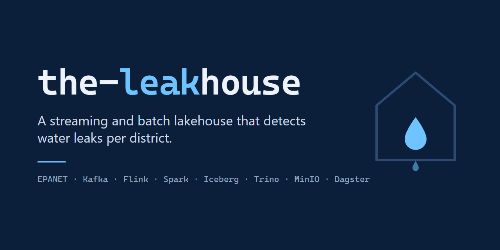
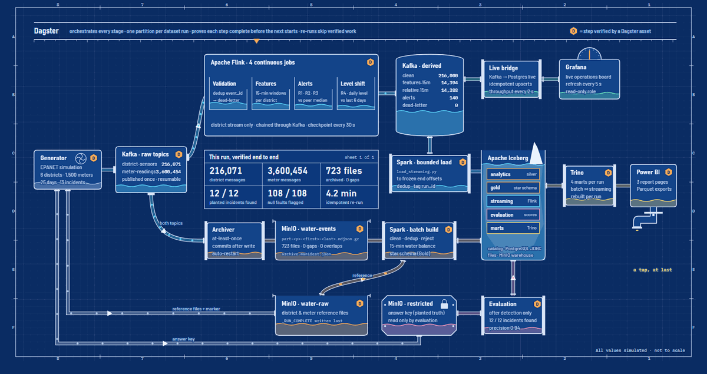

# The Leakhouse

**A streaming and batch lakehouse that finds water leaks per district, and proves it against an answer key.**

Egypt loses about 26.5% of its treated drinking water before it reaches a customer, and that loss is reported as one
national number once a year. A burst pipe needs an answer within the hour, for one district. There was no public
dataset to build that on, and real network data comes with no answer key, so this project builds both: a simulated
city whose leaks we planted, and a pipeline that has to find them without looking.

> All data in this repository is simulated. Nothing here is real utility data, and the system is not deployed.



The replay above follows one run: events split at Kafka, both paths meet in Iceberg, the answer key opens last, and
each stage gets a check once Dagster has verified it. Open [docs/pipeline-replay.html](docs/pipeline-replay.html)
for the live version, or [docs/pipeline-diagram.html](docs/pipeline-diagram.html) for a clickable tour of every component.

## How it works

```
Generator → Kafka ─┬→ Archiver → MinIO → Spark batch ─┐
                   └→ Flink → Kafka ─→ Spark load ─────┴→ Iceberg → Trino → Power BI
                                     └→ live bridge → Postgres → Grafana (live)
                      Dagster orchestrates and verifies every stage
```

| Stage | What happens |
|---|---|
| **Generate** | EPANET 2.2 (via WNTR) solves a 6-district, 1,500-meter network every minute for 25 days, with pressure-dependent demand and pressure-driven leak emitters. 3.8M events on versioned schemas, 13 planted incidents, 1,353 injected nulls and duplicates, and a restricted answer key. |
| **Ingest** | Events are published to Kafka (KRaft, keyed by event ID). An at-least-once archiver writes them to MinIO as gzip NDJSON files named by offset range, committing only after each upload. |
| **Stream** | Four chained PyFlink jobs: validation with deduplication and a dead-letter topic, 15-minute event-time windows with a 1-minute watermark, alert rules on each district's flow against the median of its peers, and a daily level-shift rule for slow losses. |
| **Batch** | PySpark cleans and deduplicates the archive and builds a 15-minute water balance and a star schema in Apache Iceberg, partitioned by run, with the catalog in PostgreSQL over JDBC. |
| **Serve** | Trino marts join streaming incidents with batch meter balances to tell leaks from demand surges and supply failures. Results go to Power BI as Parquet, and to a live Grafana board through idempotent Postgres upserts. |
| **Orchestrate** | Dagster assets on dynamic per-run partitions verify each stage from committed consumer offsets, archive offset coverage and manifest record counts. Reruns are idempotent and scoped to one run. |
| **Evaluate** | Only after detection finishes does the evaluation open the answer key. |

## Results on the reference run

| Measure | Result |
|---|---|
| Detectable planted incidents found | **12 / 12**, precision 0.94 |
| Time to confirm a burst | 30 minutes |
| Incidents explained correctly by the meters | 11 / 11 (leak, demand or supply) |
| Missing pressure readings flagged | 108 / 108 |
| Archive coverage | 723 files, 0 gaps, 0 overlaps |
| Full rerun with nothing to redo | about 4 minutes, 0 duplicated records |

The one false alarm and the one leak the stream cannot see are both explained in
[Lakehouse, marts and results](docs/06-lakehouse-and-results.md).

## What makes it different

- **Physics, not random numbers.** Leaks change flow and pressure because the network was solved, not because a spike was drawn.
- **An answer key the pipeline never reads.** Detection is graded against planted truth, including look-alikes designed to cause false alarms.
- **Proof instead of waiting.** A stage is done when offsets, file coverage and counts say so; a timeout can fail a run but never pass it.
- **Two paths, one lakehouse.** The stream says something happened; the meters say what it was.

The full reasoning is in [Design decisions](docs/07-design-decisions.md).

## Quick start (Windows PowerShell)

```powershell
.\run.ps1 setup      # once: build images, install Dagster
.\run.ps1 up         # start the services
.\run.ps1 dagster    # Dagster UI on http://localhost:3000 (keep open)
.\run.ps1 pipeline   # in a second window: run every stage
```

Everything runs in Docker on one machine. Details, timings and troubleshooting: [docs/RUNNING.md](docs/RUNNING.md).

## Repository map

| Folder | Content |
|---|---|
| `Generator/` | simulation, publisher, Kafka → MinIO archiver, validator |
| `flink/` | the four Flink detection jobs, their scripts, analysis and evaluation tools |
| `batch/` | Spark jobs: batch build and validation, streaming load into Iceberg, dashboard export |
| `orchestration/` | the Dagster project |
| `live/` | live bridge from Flink's topics to Postgres for Grafana |
| `infrastructure/` | Iceberg catalog schema, Trino catalog and marts, Grafana provisioning |
| `configs/` | dataset configurations for the pipeline and the live demo |
| `docs/` | documentation; start with [docs/README.md](docs/README.md) or [How it all works](docs/how-it-all-works.md) |

## Team

Built as the graduation project of the Samsung Innovation Campus Big Data track (SIC8), with Life Makers Foundation.

| | |
|---|---|
| Mohammed Adel | data generation and ingestion; helped build the orchestration |
| Ahmed Sayed | stream processing |
| Amr AbdEl-monem | batch processing |
| Amr Yousri Badr | orchestration |
